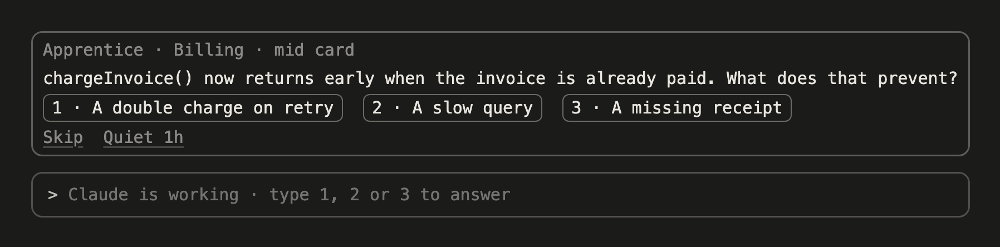
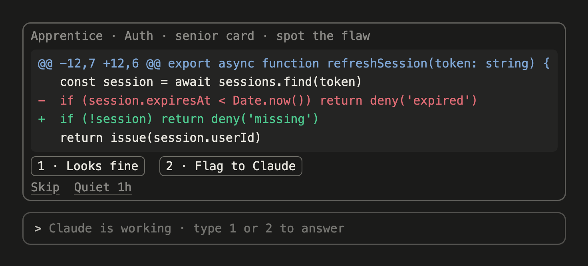
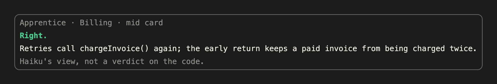
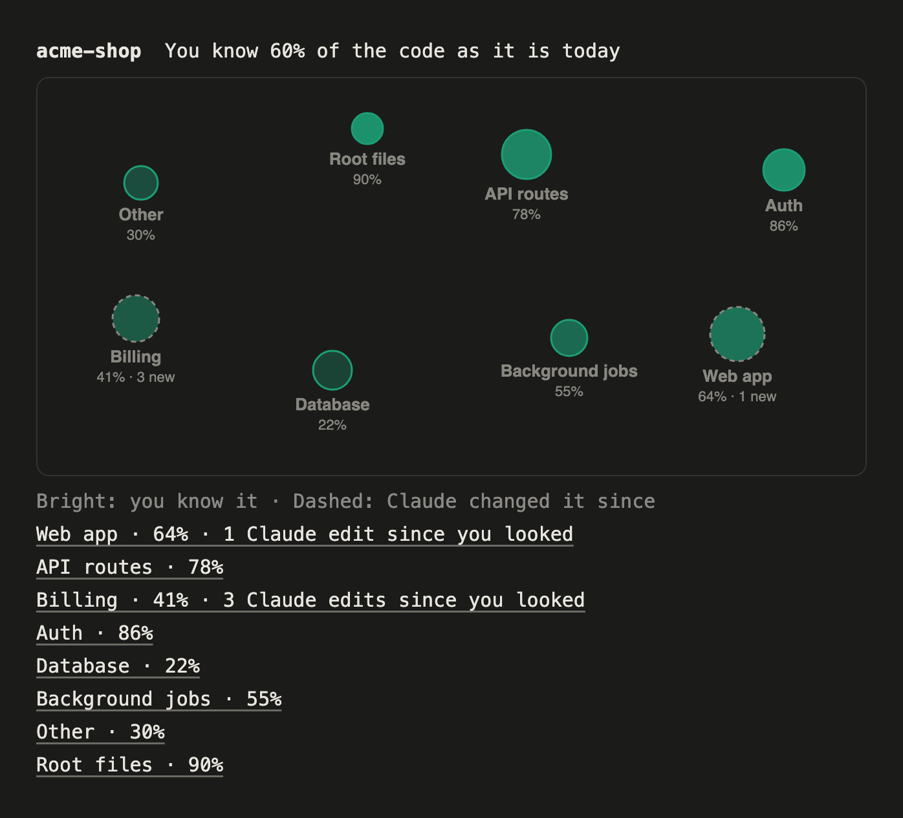
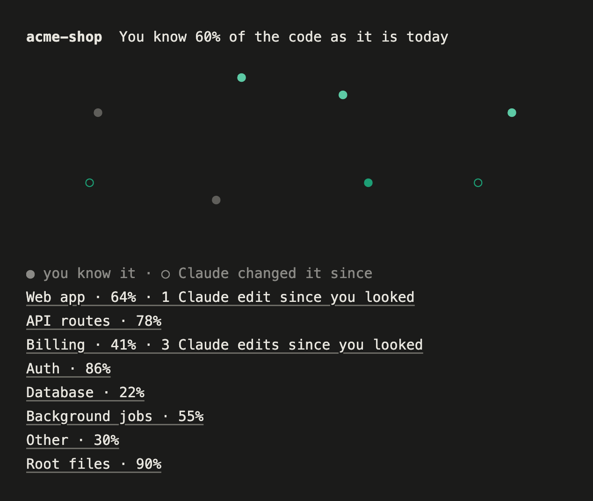
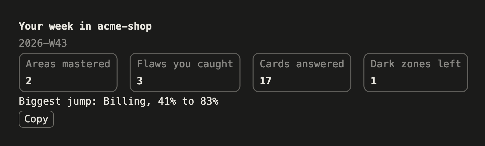

<div align="center">

# 🎓 apprentice

### Learn the code Claude is changing, while it changes it.

**Claude changed `billing/` 14 times this week. Do you still understand it?**

[](LICENSE)
[](#requirements)
[](#roadmap)
[](#requirements)
[](https://github.com/sponsors/isAlmogK)

[Why](#why-im-building-this) · [How it works](#how-it-works) · [Install](#install) · [What you see](#what-you-see) · [Commands](#commands) · [Privacy](#privacy) · [Requirements](#requirements) · [FAQ](#faq) · [Roadmap](#roadmap) · [Docs](#docs) · [Sponsor](#sponsor) · [About me](#about-me)

</div>

---

Apprentice is a mod for Claude Code. It draws a **knowledge map** of your repo that is bright where you understand the code and dim where Claude changed code you haven't seen. After each editing turn it asks **one short question** about the edit, at your level for that area, and a right answer relights the area.

No account, no server. It runs inside Claude Code and uses Haiku, through Claude Code, to write the cards. It never blocks Claude: the card sits above your prompt while Claude keeps working.

<p align="center"></p>

Type `1` into the empty prompt and the card shows the answer and a one-line explanation. Get it right and `Billing` brightens on the map again.

> [!NOTE]
> **Status: alpha.** Everything in v1 is built and covered by 110 tests, and `claude plugin validate` passes. The hand check in a live Claude Code session is still running. Watch or ⭐ the repo to follow along, and [open an issue](https://github.com/isAlmogK/apprentice-claude-mod/issues) if something looks off.

## Why I'm building this

AI agents now write a large share of the code I ship. Writing it is no longer the slow part. **Understanding it is.** Code changes faster than its owners can read it, and the gap grows quietly. I call that gap **comprehension debt**: code that changed since you last understood it.

Juniors feel it as "I ship code I can't explain." Seniors feel it as "Claude changed `billing/` 14 times this week and I haven't looked." Nothing in Claude Code measures that gap, or helps pay it down.

| | Shows what changed | Shows what you still understand | Teaches you while the agent works |
|---|---|---|---|
| Reading the diff | ✅ | ❌ | ◐ if you read every one |
| Pull request review | ✅ | ❌ | ❌ after the fact |
| `git blame` | ✅ who wrote it | ◐ only what you wrote | ❌ |
| **Apprentice** | ✅ **per area, on a map** | ✅ **a score per area** | ✅ **one card per editing turn** |

The map shows how much of your codebase you still understand, and the cards teach you the rest while Claude works, a few seconds at a time.

## How it works

```
Claude edits a file ─▶ its area dims ─▶ Haiku writes one card ─▶ you answer ─▶ the area relights
```

| | What it does | Uses Haiku |
|---|---|---|
| 🗺️ **Map** | Groups the repo into at most 15 areas and seeds each score from `git blame`: lines you wrote count as lines you understand, up to 90% | Once per map, to name the areas |
| 🌘 **Dim** | Every Claude edit (`Edit`, `Write`, `MultiEdit`) lowers its area's score by the share of the area's lines it changed | No |
| 🃏 **Card** | After the first edit of a turn, one card about that edit. Junior and mid areas get a question with three answers; senior areas get a spot-the-flaw card with the diff | Yes, at most 6 an hour |
| 💡 **Relight** | A right answer gives back what the edit took, plus 2 points. A wrong one gives back a quarter and shows the explanation. Three right in a row move the area up a level; two wrong move it down | No |

Your level per area starts from your seed score: under 40% is junior, under 75% is mid, above that is senior. A senior who wrote most of an area gets spot-the-flaw cards from the first edit.

## Install

In Claude Code:

```
/plugin marketplace add isAlmogK/apprentice-claude-mod
/plugin install apprentice@apprentice
```

Then open a git repo and run `/apprentice`.

**From source:**

```bash
git clone https://github.com/isAlmogK/apprentice-claude-mod.git
claude --plugin-dir apprentice-claude-mod
```

## What you see

The images below are drawn from Apprentice's own view code with demo data (`node scripts/screenshots.ts`), so the text and layout match what the mod draws. Claude Code's own styling differs a little between the Desktop app and the terminal.

**The band.** After Claude's first edit of a turn, a card appears above your prompt while Claude keeps working. Juniors and mids get a question with three numbered answers. Seniors get a spot-the-flaw card: the diff Claude just wrote, with **Looks fine** and **Flag to Claude**. Flag to Claude sends Claude a short note about the concern once it's idle. Answer with a click, or type `1`, `2` or `3` into the empty prompt. A wrong answer still shows the explanation. **Skip** keeps the card in the area's list for later; **Quiet 1h** pauses cards.

<p align="center"></p>
<p align="center"></p>

**The map.** `/apprentice` groups your repo into at most 15 areas, names them, and seeds each score from `git blame`. Each area is a star with its name under it, sized by its share of the code and brighter the more you know it. A dashed outline means Claude changed it since you last looked. Under the map, each area is a button for its details: rename it, merge it into another, or bring back a skipped card.

<p align="center"></p>

The terminal draws the same map as a character grid:

<p align="center"></p>

**Codebase Wrapped.** Once a week, when you've answered at least 5 cards, a toast says your week is ready. `/apprentice wrapped` shows areas mastered, flaws you caught, cards answered, dark zones left and your biggest jump. **Copy** puts a text version on your clipboard, ready to post. It never contains code.

<p align="center"></p>

## Commands

| Command | Does |
|---|---|
| `/apprentice` | Opens the map (maps the repo first if needed) |
| `/apprentice wrapped` | Opens this week's Codebase Wrapped |
| `/apprentice quiet [minutes]` | Pauses cards, 60 minutes by default. Dimming continues |
| `/apprentice remap` | Regroups the areas. Areas that keep their id keep what you learned |

Every worktree of a repo shares one map, so a session in a linked worktree sees and updates the same scores.

## Privacy

Everything stays on your machine except what Apprentice asks Haiku, through Claude Code.

**Goes to Haiku:**

- For each card: one edit's diff (at most 120 lines), the file's path and the area's name.
- Once per map: the area folder paths and up to five file names per area, to name the areas, with secret-looking paths left out.

**Never goes to Haiku:**

- Paths that look secret (`.env*`, `*.pem`, `*.key`, `id_rsa*`, `id_ed25519*`, anything with `secret` or `credential` in the path). Their edits still dim the map, but they never get a card.
- Files git ignores. If git can't tell, the file is treated as ignored.
- File contents beyond the edit's diff.

Scores, answers and skipped cards are stored locally in Claude Code's mod store. At most 6 card requests go to Haiku an hour.

## Requirements

- Claude Code v2.1.296 or later.
- The Claude Code Desktop app or the terminal. The VS Code extension isn't supported in v1, because it doesn't draw the band above the prompt.
- A git repo.

## FAQ

<details>
<summary><b>Does it slow Claude down or block it?</b></summary>

No. The card is made in the background after Claude's edit and appears above the prompt while Claude keeps working. If anything in Apprentice fails, Claude's edit goes through unchanged and no card appears.
</details>

<details>
<summary><b>What does it cost?</b></summary>

Cards are written by Haiku through Claude Code, so they count toward your Claude Code usage: at most 6 card requests an hour, plus one call each time the repo is mapped. `/apprentice quiet` stops cards; dimming needs no model.
</details>

<details>
<summary><b>Does it judge whether Claude's code is right?</b></summary>

No. A spot-the-flaw card asks whether *you* see a problem, and the answer is Haiku's view, not a verdict on the code. For checking the change itself, see [trustbut](https://github.com/isAlmogK/trustbut) and [Holdline](https://github.com/isAlmogK/holdline).
</details>

<details>
<summary><b>Does anyone else see my scores?</b></summary>

No. Scores live in Claude Code's local mod store on your machine. Codebase Wrapped is shared only if you copy it and post it yourself.
</details>

## Roadmap

| Phase | Scope | State |
|---|---|---|
| v1 | Knowledge map (Desktop and terminal), question and spot-the-flaw cards, Flag to Claude, Codebase Wrapped, rename and merge areas | ✅ Built |
| Launch | Hand check in a live session, first release | 🚧 In progress |
| Later | Lines between areas that change together, VS Code support, cards for edits made by people, a team view for onboarding | Planned |

## Docs

- 📘 [How it works today](docs/apprentice.md): areas, scoring, cards, storage and surfaces as the code stands
- 🧭 [Design spec](docs/superpowers/specs/2026-10-23-apprentice-design.md): the why, the user flow and the decisions, with an "As built" section
- 🗂️ [Implementation plan](docs/superpowers/plans/2026-10-23-apprentice.md): the task-by-task plan it was built from

Apprentice is built test first, largely by AI agents working from written specs and plans, with every task reviewed before it merges. All logic lives in `src/` as plain TypeScript with no mods API, and only `hooks/register.ts` talks to Claude Code. Read [CLAUDE.md](CLAUDE.md) before changing it. Issues and ideas are welcome.

## Contributing

```bash
claude plugin test        # the whole test suite
claude plugin validate .  # the manifest and hooks module
```

Run both before every commit. To try a change, start Claude Code with `claude --plugin-dir <path to your clone>`. After changing a view, run `node scripts/screenshots.ts` (Node 22.18 or later and Google Chrome) to redraw the images in `docs/images/`.

## Sponsor

Apprentice is free and open source, and I build it in my own time. If it helps you keep up with the code your agent writes, [sponsoring me on GitHub](https://github.com/sponsors/isAlmogK) keeps it maintained and moving down the [roadmap](#roadmap).

## About me

I'm Almog Koren, a software engineer in Tallinn with more than 15 years of shipping production software. I founded and built [DogBase](https://www.dogbase.co), a bootstrapped SaaS for working-dog teams that won the main pitch competition at Latitude59 2026, and before that I was co-founder and CTO of Platfarm, which was acquired. I took both companies through Techstars.

These days I mostly build AI agents and the systems around them. Apprentice is the third of my tools for working with them, and they don't overlap: [trustbut](https://github.com/isAlmogK/trustbut) proves a change is actually tested, [Holdline](https://github.com/isAlmogK/holdline) proves it didn't break a business rule you approved, and Apprentice makes sure you still understand it. It came out of my own work: I wanted to keep understanding the code my agents were changing.

**I'm open to work:** full-time roles, fractional CTO work and AI agent projects. My CV and contact details are at [almog.io](https://almog.io).

## License

[Apache-2.0](LICENSE)

---

<div align="center">

Built by **Almog Koren** · [almog.io](https://almog.io) · [@isAlmogK](https://github.com/isAlmogK). If Apprentice helps you keep up with your agent, a ⭐ helps others find it, and [sponsoring](https://github.com/sponsors/isAlmogK) helps keep it going.

</div>
